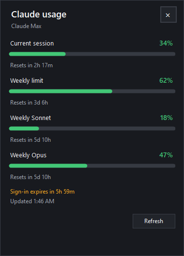

# Claude Usage Tray

An unofficial, open-source Windows system tray monitor for Claude Code subscription limits.



It shows the same usage windows that Claude Code exposes for subscription accounts: the current 5-hour session, the weekly limit, and the model-specific weekly limit when available.

> [!IMPORTANT]
> This project is not affiliated with, endorsed by, or supported by Anthropic. “Claude” and “Claude Code” are trademarks of Anthropic.
>
> This tool reads the OAuth access token that Claude Code stores on your machine and sends it to an **undocumented, unsupported** Anthropic endpoint (`/api/oauth/usage`). This is not a public API: it may change or break without notice, and reusing the token this way is at your own risk and could, in principle, affect your account. Use it only if you accept that risk.

## Features

- Native Windows 10/11 tray application; no Electron or browser window.
- Dynamic battery icon based on the most-used quota window, legible on light and dark taskbars.
- Compact popup that follows your Windows light/dark theme, with per-window percentages and reset countdowns.
- Shows the 5-hour session, the weekly limit, and both weekly model windows (Sonnet and Opus) when available.
- Automatic refresh (configurable interval: 1/5/15/30 min) and manual refresh from the tray menu.
- Configurable low-usage notifications (default at 80% and 95%), which can be turned off.
- Warns in the popup shortly before your Claude Code sign-in expires.
- Optional launch at Windows sign-in and optional startup update check.
- Reads Claude Code OAuth credentials from native Windows or the default WSL distribution.
- Does not collect telemetry, run a server, or store a copy of your token.

## Install

1. Install Claude Code and sign in with a Claude Pro or Max account. If you are
   not signed in yet, launch Claude Code and run the `/login` command:

   ```text
   claude
   > /login
   ```

   Alternatively, generate a long-lived token with `claude setup-token` and expose
   it to this app via the `CLAUDE_CODE_OAUTH_TOKEN` environment variable.

2. Download `ClaudeUsageTray-win-x64.zip` (or `-win-arm64.zip`) from the repository's Releases page.
3. Optionally verify the download against the published `.sha256` file:

   ```powershell
   (Get-FileHash .\ClaudeUsageTray-win-x64.zip -Algorithm SHA256).Hash
   ```

4. Extract it and run `ClaudeUsageTray.exe`.
5. If Windows SmartScreen appears, inspect the publisher/repository and choose **Run anyway** only if you trust this build. Community builds are not code-signed yet.

The release is self-contained, so users do not need to install .NET separately.

## Credential lookup

The application checks, in order:

1. `CLAUDE_CODE_OAUTH_TOKEN` in the current process environment.
2. `%USERPROFILE%\.claude\.credentials.json` from native Windows Claude Code.
3. `%USERPROFILE%\.config\claude\.credentials.json` (alternative native location).
4. `~/.claude/.credentials.json` inside the default WSL distribution.

Tokens are held only in process memory and sent only to `https://api.anthropic.com/api/oauth/usage`. They are never included in logs, notifications, or local application settings. See [PRIVACY.md](PRIVACY.md).

API-key, Amazon Bedrock, Google Vertex AI, and Anthropic Console billing accounts do not expose Claude subscription windows through this endpoint and are currently out of scope.

## Settings

Right-click the tray icon to configure the theme (System/Dark/Light), refresh interval, low-usage notifications, launch at startup, and the optional update check. The interface is shown in English or Russian based on your Windows display language. Preferences are saved to `%APPDATA%\ClaudeUsageTray\settings.json`.

## Build from source

Requirements: Windows 10/11 and the .NET 8 SDK or newer.

```powershell
dotnet build ClaudeUsageTray.sln --configuration Release
dotnet run --project src/ClaudeUsageTray -- --demo
```

Run the unit tests and the built-in offline parser checks:

```powershell
dotnet test ClaudeUsageTray.sln --configuration Release
dotnet run --project src/ClaudeUsageTray -- --self-test
```

Preview the popup without Claude credentials:

```powershell
dotnet run --project src/ClaudeUsageTray -- --demo
```

Create a self-contained single-file executable (swap `win-arm64` for an ARM build):

```powershell
dotnet publish src/ClaudeUsageTray/ClaudeUsageTray.csproj `
  --configuration Release `
  --runtime win-x64 `
  --self-contained true `
  -p:PublishSingleFile=true `
  --output publish/win-x64
```

## Release workflow

Push a tag such as `v0.1.0`. The GitHub Actions release workflow builds self-contained `win-x64` and `win-arm64` single-file packages (with the version taken from the tag), writes a `.sha256` checksum for each, and publishes them to a GitHub Release.

Before the first public release:

- Enable GitHub Actions for the repository.
- Set `RepositorySlug` in `src/ClaudeUsageTray/Infrastructure/UpdateChecker.cs` to your `owner/repo` if you want the optional update check to work.
- Review the generated binary with your preferred antivirus service.
- Consider Authenticode code signing to avoid SmartScreen warnings.

## Contributing

Bug reports and pull requests are welcome. Please read [CONTRIBUTING.md](CONTRIBUTING.md) and [SECURITY.md](SECURITY.md) first.

## License

[MIT](LICENSE)
